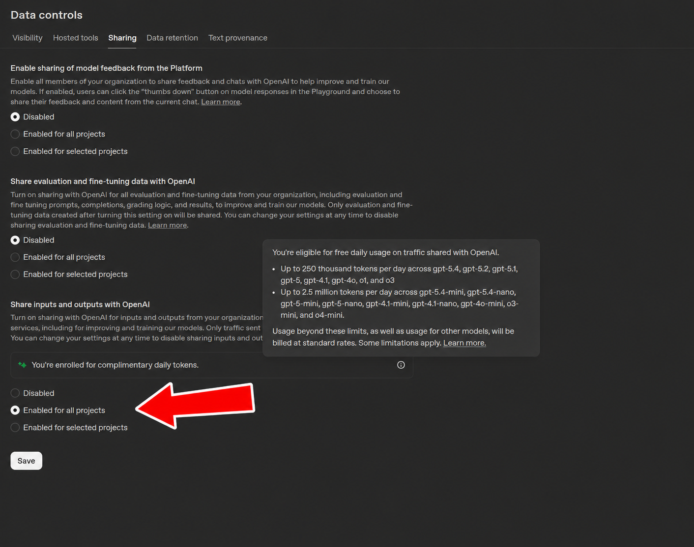

# OpenAI Free Tokens Guard

**OpenAI gives you up to 2.75 million free tokens a day. Go one token over and it quietly bills your card.** This keeps you under the line, in any app.

Top up **$5** on your OpenAI account (that puts you on the **Build** tier), turn on data sharing, and if your org is shown the offer you get every day:

| Usage tier | Large models (gpt-6-luna, gpt-6-sol, gpt-5.5, o3, …) | Mini models (gpt-5.6-luna, gpt-5.6-terra, gpt-5-mini, …) |
|---|---|---|
| **Build** ($5) | **250,000 / day** | **2,500,000 / day** |
| Launch ($100) | 1,000,000 / day | 10,000,000 / day |
| Grow ($500) | 1,000,000 / day | 10,000,000 / day |

Resets at 00:00 UTC. Details and the full model list: [OpenAI help article](https://help.openai.com/en/articles/10306912). Your tier is shown on [platform.openai.com/settings/organization/limits](https://platform.openai.com/settings/organization/limits).

**Turn it on:** [Settings → Data controls → Sharing](https://platform.openai.com/settings/organization/data-controls/sharing), "Share inputs and outputs with OpenAI" → enabled. If your org qualifies you'll see "You're enrolled for complimentary daily tokens":



Only traffic you share counts, and OpenAI uses it to train its models, so keep secrets and private data out of it.

**The catch:** nothing stops you at the limit. OpenAI just starts billing, and the request that crosses the line is billed **in full**. A coding agent can burn through 250K tokens in a few turns.

## What the guard does

- **Meters** every request per pool and per UTC day (cached and reasoning tokens included, as OpenAI counts them).
- **Alerts** at **85 %** and **95 %**.
- **Soft stop**: at **95 %**, or when the next request would cross the free limit, or on a model the offer doesn't cover, it tells the working agent to stop and write a `HANDOFF.md` in the project. Nothing is cut off: tell the agent to carry on and it will.
- **Shows the meter** in opencode's TUI sidebar: tokens used and left and % per pool, with a bar that is green, then orange from 50 %, then red from 85 %, plus the time to reset.
- **Hard block (opt-in)**: with `"onExhausted": "block"`, a request that would cross the limit is never sent.

## Use it in your own app (any language)

Point your coding agent at [`SPEC.md`](SPEC.md). It is written for agents: the offer's rules, what to count, where to gate, and checks the port must pass.

> Read SPEC.md from https://github.com/giri256/openai-free-tokens-guard and add the free-tokens guard to this app. My usage tier is Build.

Works the same for a mobile app's backend, a Discord bot, a script, or a personal tool.

## Use it in opencode (ready-made)

This repo is also an opencode plugin (opencode 2.x).

```bash
opencode plugin add github:giri256/openai-free-tokens-guard
```

or add it to `~/.config/opencode/opencode.json`:

```json
{ "plugins": ["github:giri256/openai-free-tokens-guard"] }
```

Then set your tier in `~/.config/opencode/openai-free-tokens.json` (see [`openai-free-tokens.example.json`](openai-free-tokens.example.json)):

```json
{ "tier": "build" }
```

It guards the `openai` provider when you are connected with an **API key** (ChatGPT-login traffic is not API-billed and is left alone).

The session sidebar of the opencode TUI gets an **OpenAI free tokens** section above Context, refreshed every 2 s. Each pool's bar and percentage are **green** below 50 %, **orange** from 50 %, **red** from 85 %:

```
OpenAI free tokens

Large models                      44%
████████████████░░░░░░░░░░░░░░░░░░░░░
111,013 used · 138,987 left

Mini models                        0%
░░░░░░░░░░░░░░░░░░░░░░░░░░░░░░░░░░░░░
0 used · 2,500,000 left

Resets in 22h 45m · 00:00 UTC
```

Check the meter from a shell, without spending tokens:

```bash
npx --allow-git=all github:giri256/openai-free-tokens-guard status
```

`steps` prints the per-request breakdown (fresh input, cache read, cache write, output, reasoning), `set big 120000` syncs today's count with OpenAI's usage dashboard (needed if other apps use the same org).

<details>
<summary>All options</summary>

| Option | Default | |
|---|---|---|
| `tier` | `build` | `build`, `launch` or `grow` |
| `limits` | from tier | `{ "big": n, "mini": n }` |
| `alertAt` | `[0.85, 0.95]` | alert thresholds |
| `wrapUpAt` | `0.95` | soft stop: ask the agent for a handoff (also when the next request would cross the limit) |
| `onExhausted` | `stop` | `stop` (soft, agent is told to stop), `block` (hard: request not sent) or `warn` (notification only) |
| `onUncoveredModel` | `stop` | `stop`, `block`, `warn` or `allow` |
| `outputReserve` | `16000` | tokens reserved for the reply in each estimate |
| `capOutput` | `true` | block mode only: near the limit, cap the reply so the request can't cross it |
| `handoffFile` | `HANDOFF.md` | written in the session's directory |
| `notify` | `true` | desktop notifications (Linux, macOS, Windows) |
| `models` / `extraModels` | built-in lists | replace / extend the pool lists |
| `providers` | `["openai"]` | opencode provider ids to guard |
| `debug` | `false` | trace to `~/.local/share/opencode-openai-free-tokens/debug.jsonl` |

Options can also be given in `opencode.json`: `{ "package": "github:…", "options": { "tier": "build" } }`.
</details>

## What a compaction really costs

Measured live on a gpt-6-luna session with a 105K-token context:

| Request | Fresh input | Cache read | Cache write | Output + reasoning | Total |
|---|---|---|---|---|---|
| Compaction | 3 | **0** | 105,626 | 2,327 | **107,956** |
| First turn after (step 1) | 3 | **0** | 30,482 | 1,033 | 31,518 |
| First turn after (step 2) | 2,654 | 30,482 | 1,054 | 5 | 34,195 |

- A compaction re-sends the **whole** conversation and gets **no cache hit**: on Build tier one compaction of a full session uses ~43 % of the daily large-model pool.
- The context drops from ~105K to ~30K tokens, and the first request after it is again a full cache miss.
- Every tool call is another full request, so the per-turn cost scales with context × steps.

## Limits of the guard

- It sees only the traffic of the app it runs in. Other apps on the same OpenAI org: use `set` (or the spec's manual override).
- Eligibility, data sharing and the model lists are OpenAI's to change; the lists are configurable.
- OpenAI-hosted tools (web search etc.) are billed separately and not metered.

## License

MIT
